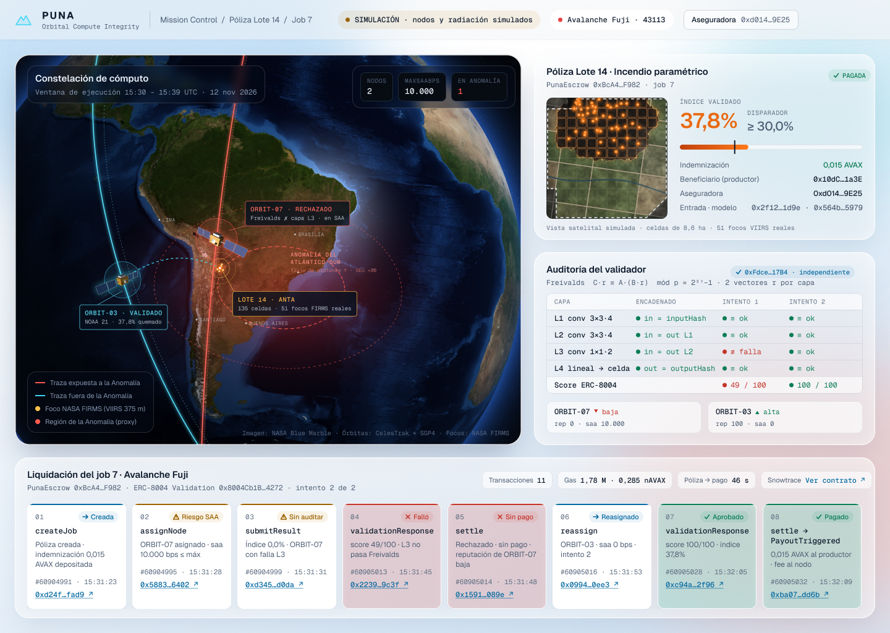

# PUNA — Proof of Untampered Neural Answers

> Cuando el satélite que decide si te pagan el seguro pasa por la Anomalía del Atlántico Sur, un bit dado vuelta te puede costar la cosecha: PUNA hace que un tercero audite el cálculo y el contrato pague solo si la cuenta es correcta.



**Argentina Space Hackathon 2026** · Track Avalanche · Agentes × Geoespacial

## Qué hace
1. Una cooperativa o fondo mutual crea una póliza paramétrica de incendio para un lote. Para eso llama a `PunaEscrow.createJob` en Avalanche Fuji, con la indemnización y los fees depositados.
2. Un scheduler orbital asigna un nodo de cómputo según su exposición a la Anomalía del Atlántico Sur (`saaBps`, calculado con TLE de CelesTrak + SGP4).
3. El nodo corre una CNN entera sobre la grilla del lote (focos NASA FIRMS / VIIRS). Publica el índice, `outputHash` y la raíz Merkle por capa, y pide validación en **ERC-8004**.
4. Un validador de otro operador verifica cada capa con **Freivalds módulo 2³¹−1** y el encadenado completo, y responde con un score.
5. `settle` paga al productor si el índice está validado y supera el disparador. Si el validador rechaza, no se mueve plata, baja la reputación y el job se reasigna a otro nodo.

## Correr
```bash
cd contracts && forge test           # 13 tests, incluye el guion de la demo y fuzz de conservación de fondos
pip install -e ".[dev]" && pytest -q # modelo entero, Freivalds, Merkle, inyección de fallas, órbita
```
Copiá `.env.example` a `.env` para deploy y FIRMS. Más detalle en [`CLAUDE.md`](CLAUDE.md) y [`docs/resumen-tecnico.md`](docs/resumen-tecnico.md).

## Real vs simulado
| Real | Simulado (y etiquetado) |
|---|---|
| Órbitas (TLE CelesTrak + SGP4), focos NASA FIRMS, verificación Freivalds, transacciones en Fuji, registros ERC-8004 | Satélites/nodos de cómputo, operadores, radiación (proxy `saaBps`), vista satelital del lote |

## ERC-8004 en Fuji
| Registro | Dirección |
|---|---|
| Identity | `0x8004A818BFB912233c491871b3d84c89A494BD9e` |
| Reputation | `0x8004B663056A597Dffe9eCcC1965A193B7388713` |
| Validation | `0x8004Cb1BF31DAf7788923b405b754f57acEB4272` (confirmado en H0) |

## Límites
- PUNA prueba que el cálculo es correcto, no que la imagen de entrada sea auténtica.
- Hoy el índice se puede calcular en tierra. Cuando nazca en órbita, sin PUNA no hay forma de auditarlo.
- Somos complementarios a la detección de bit-flips (p. ej. Flipless): verificación por terceros, pago on-chain y ubicación orbital.

Atribución de datos e imágenes en [`docs/ATTRIBUTION.md`](docs/ATTRIBUTION.md).
